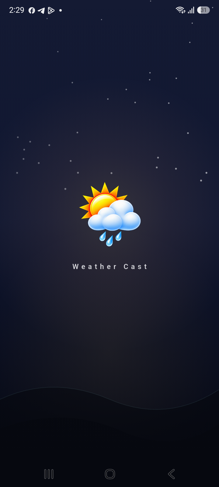
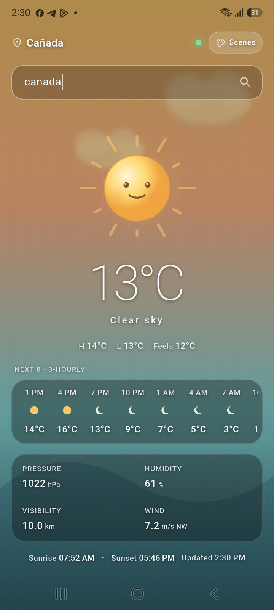
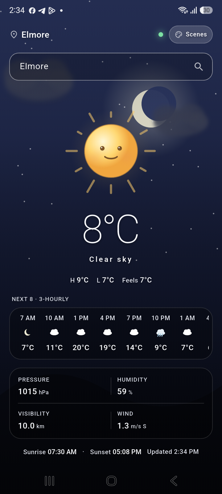
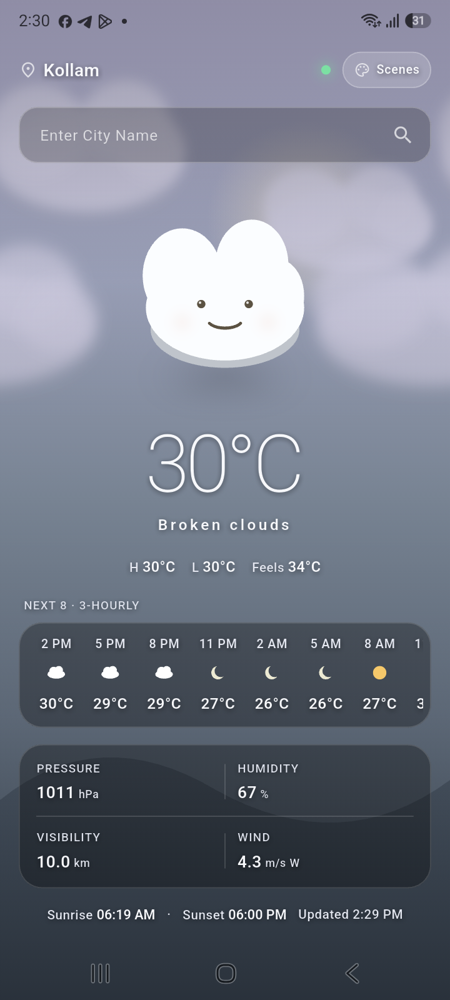
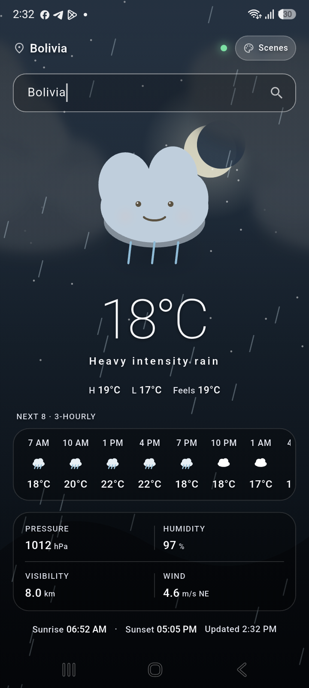
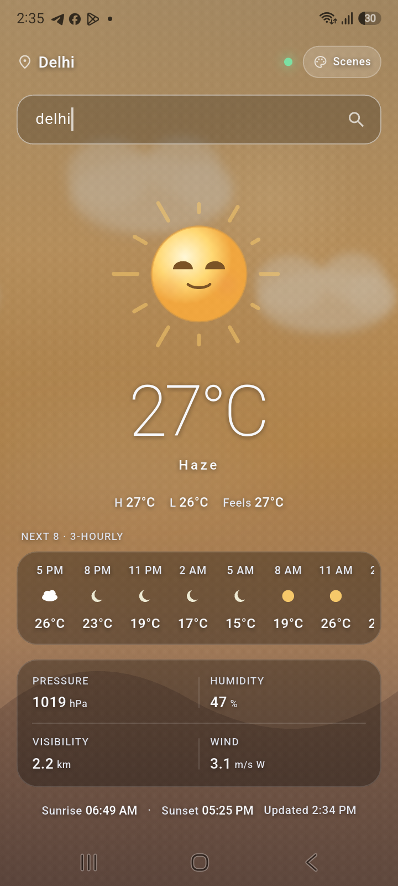
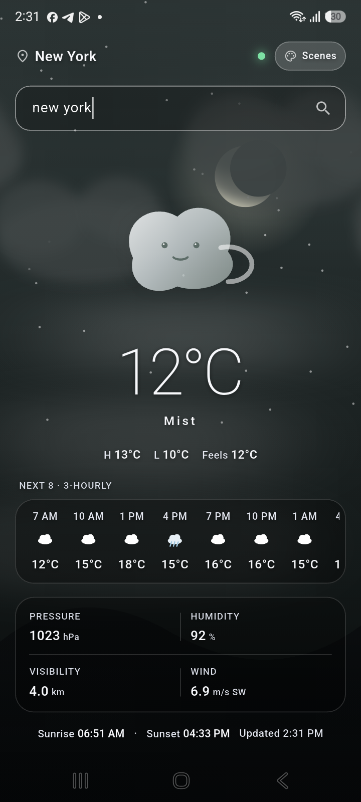

# Weather Cast 🌤️

A Flutter weather application powered by the OpenWeatherMap API. Get current weather conditions and forecasts with a clean, dynamic interface.

## Features

- Current weather information
- Weather forecasts
- Automatic weather detection using device location
- Search weather by city
- Location permission handling
- Network connectivity monitoring
- Dynamic weather backgrounds
- Custom splash screen
- Responsive user interface

## Screenshots & Preview

### App Preview

[Watch the app preview video](screen-preview/preview.mp4)

### Screenshots

<table>
  <tr>
    <td align="center">Splash Screen</td>
    <td align="center">Clear Sky</td>
     <td align="center">Clear Sky at Night</td>
  </tr>
  <tr>
    <td></td>
    <td></td>
   <td></td>
  </tr>
  <tr>
    <td align="center">Clear Sky at Night</td>
    <td align="center">Clouds</td>
  </tr>
  <tr>
     <td align="center">Clouds</td>
    <td align="center">Rain</td>
    <td align="center">Haze</td>
  </tr>
  <tr>
       <td></td>
    <td></td>
    <td></td>
  </tr>
  <tr>
    <td align="center">Mist</td>
    <td></td>
  </tr>
  <tr>
    <td></td>
    <td></td>
  </tr>
</table>

## Tech Stack

- Flutter
- Dart
- OpenWeatherMap API
- Geolocator
- HTTP
- Internet Connection Checker
- Envied

## Getting Started

### Prerequisites

- Flutter SDK
- Dart SDK
- An IDE such as Android Studio or VS Code
- An OpenWeatherMap API key

### 1. Clone the repository

```bash
git clone https://github.com/mr-bipolar/weather-cast.git
cd weather-cast
```

### 2. Install dependencies

```bash
flutter pub get
```

### 3. Configure your API key

Create a `.env` file in the project root:

```env
WEATHER_KEY=your_openweathermap_api_key
```

Get your API key from [OpenWeatherMap](https://openweathermap.org/api).

**Never commit your `.env` file or share your API key publicly.**

### 4. Generate environment configuration

Run:

```bash
dart run build_runner build --delete-conflicting-outputs
```

### 5. Run the application

```bash
flutter run
```

## Running Tests

Run the test suite:

```bash
flutter test
```

Check code quality:

```bash
flutter analyze
```

## Project Structure

```text
lib/
├── core/
├── model/
├── service/
├── shared/
├── view/
└── main.dart

screen-preview/
├── clear-sky-night.png
├── clear-sky.png
├── clouds.png
├── haze.png
├── mist.png
├── preview.mp4
├── rain.png
└── splash-screen.png

.env
```

## Accessing Debug UI Preview

The Debug UI Preview is available only when running the app in debug mode.

1. Clone the repository and complete the setup.
2. Run the application in debug mode:

   ```bash
   flutter run
   ```

3. Open the app's Debug Preview screen from the debug preview entry point in the application.

The preview screen lets you explore different weather conditions and UI styles without waiting for real weather API responses.

**Note:** The Debug Preview feature is intended for development and testing. It is not available in release builds.


*The project structure above is illustrative; adjust it to match the actual source tree.*

## Contributing

Contributions, bug reports, and feature suggestions are welcome.

1. Fork this repository.
2. Create a feature branch.
3. Make your changes.
4. Run tests and static analysis.
5. Submit a Pull Request.

## License

The original source code of Weather Cast is licensed under the MIT License.

**Excluded assets and third-party services:**
- App icons, logos, and project branding are not covered by the MIT License. All rights reserved.
- OpenWeatherMap API services and weather data are subject to OpenWeatherMap's own terms and licensing.
- Third-party dependencies retain their respective licenses.